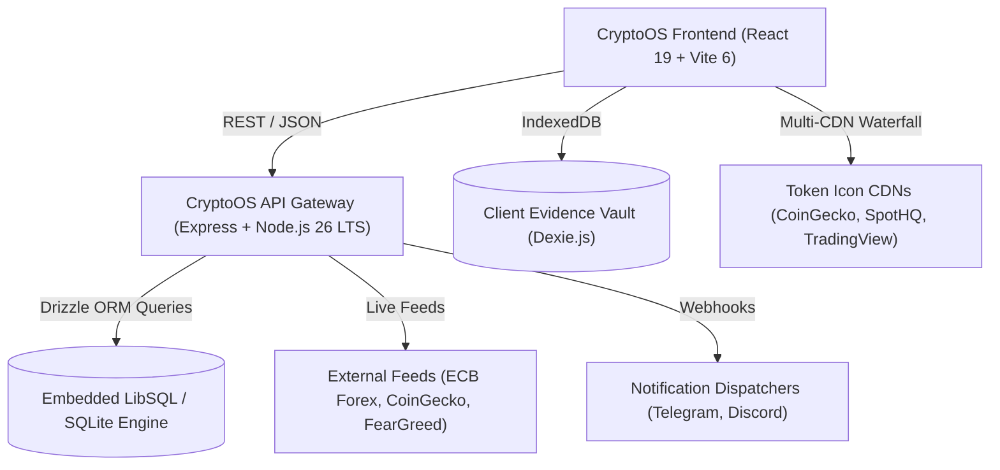

<div align="center">

# 🌌 CryptoOS
### Quantitative Trading Terminal & Market Intelligence Operating System

[](https://www.typescriptlang.org/)
[](https://react.dev/)
[](https://vitejs.dev/)
[](https://www.nodejs.org/)
[](https://www.sqlite.org/)
[](.github/workflows/ci.yml)
[](LICENSE)

<p align="center">
  <strong>A private, Bloomberg Terminal-grade crypto intelligence engine, macro cycle workstation, asymmetric risk sizer, behavioral journal, and autonomous disaster recovery vault.</strong>
</p>

### ⚡ Get Involved
<p align="center">
  <a href="#-project-status--roadmap"><strong>[ 🧭 Roadmap & Help Wanted ]</strong></a>
  &nbsp;•&nbsp;
  <a href="CONTRIBUTING.md"><strong>[ 🤝 Contributing Guide ]</strong></a>
  &nbsp;•&nbsp;
  <a href="https://github.com/ilhamrizanto/CryptoOS/issues"><strong>[ 🐛 Report an Issue ]</strong></a>
  &nbsp;•&nbsp;
  <a href="#-support--services"><strong>[ 💼 Support & Services ]</strong></a>
</p>

[Key Features](#-key-capabilities) •
[Architecture](#-architectural-overview) •
[Quickstart](#-quickstart-guide) •
[Modules](#-core-terminal-modules) •
[API Specification](#-api-endpoints-summary) •
[Roadmap](#-project-status--roadmap) •
[Contributing](#-contributing) •
[License](#-license)

</div>

---

## 🌟 Executive Overview

**CryptoOS** is an institutional-grade, personal quantitative trading terminal engineered to replace fragmented browser tabs with a unified, high-performance financial command center.

Built with an unapologetic **Cardless Pure Black (`#000000`) OLED** design language, CryptoOS provides real-time macroeconomic synthesis, multi-timeframe trade ideation, mathematical lot sizing via the **Half-Kelly Criterion**, early liquidation defense, behavioral psychology journaling, and **self-contained disaster recovery snapshots**.

The MVP roadmap (M0–M11) is **fully implemented** — authentication, market intelligence, trade pipeline, risk calculator, behavioral journal, multi-exchange portfolio, treasury ledger, analytics dashboard, PWA polish, and Docker deployment are all shipped. The project is now **open for community contributors** to drive the next phase of development.

---

## ⚡ Key Capabilities

### 1. 🌐 Global Macro Intel & Fed Watch Engine
* **Federal Reserve Interest Rate Monitor**: Real-time gauge of rate hike/cut probabilities with institutional visual indicators.
* **Capital Rotation & Dominance Radar**: Live telemetry tracking BTC Dominance (`BTC.D`), Stablecoin Flow (`USDT.D`), and Altcoin Market Cap (`TOTAL3`).
* **Fear & Greed Sentiment Meter**: Historical and real-time sentiment telemetry to spot asymmetric market tops and bottoms.
* **Dual Currency Engine**: Seamless real-time conversion between US Dollar (`USD`) and Indonesian Rupiah (`IDR`) backed by live ECB forex feeds.

### 2. 🧪 Pipeline & Quantitative Idea Incubator
* **Floating Glass Capsule HUD**: Centered, distraction-free floating telemetry pill showing active pipeline statistics, total potential reward, and aggregate risk.
* **Multi-Timeframe Trade Canvas**: High-contrast cards for drafting setups (HTF 1W/1D down to 4H/15m) with asymmetric Risk:Reward telemetry.
* **One-Click Calculator Transfer**: Seamlessly bridge pipeline setups into the Risk Sizer without re-entering parameters.

### 3. 🛡️ Position Sizer & Kelly Defense Engine
* **Dynamic Multi-CDN Token Engine**: Auto-resolves verified official logos for any cryptocurrency (over 500+ tokens) with fallback waterfalls and deterministic avatars.
* **Mathematical Risk-Neutral Lot Sizing**: Calculates exact lot sizes in coins and fiat to strictly enforce a pre-set risk tolerance percentage.
* **Interactive Liquidation Safety Gauge**: Tri-color visual track displaying the safety margin between Stop Loss and Liquidation threshold.
* **Half-Kelly Criterion Sizer**: Interactive win-rate simulator that recommends optimal capital allocation to maximize geometric capital growth without risk of ruin.
* **Direct Journal Dispatch**: Single-click button that populates the setup directly into the Trade Journal.

### 4. 📓 Behavioral Trade Journal & Evidence Locker
* **Execution & Psychology Tracking**: Logs emotional states (`Calm`, `FOMO`, `Anxious`, `Revenge`) alongside trade entries.
* **IndexedDB Screenshot Evidence Vault**: Attach chart screenshots directly to trades without third-party image hosting vulnerabilities.
* **Real-Time PnL Realization**: Interactive trade close modal with automated net PnL calculations and lesson capture.
* **Psychological Discipline Matrix**: Quantifies emotional capital leaks vs disciplined alpha performance.

### 5. 🔐 Autonomous Disaster Recovery & Data Vault
* **Per-User Isolated Master Backup**: Generates complete `.json` cryptographic snapshot archives bundling trade entries, cashflow mutations, trade ideas, spot holdings, and local terminal preferences.
* **Pre-Flight Archive Verification Inspector**: Validates file integrity, checksum, and records before applying changes.
* **Flexible Restoration Strategy**: Supports both **Merge (Append)** and **Clean Rebuild (Overwrite)** restore modes.
* **Automated Browser Snapshot Cache**: Client-side backup cache that updates silently when positions are logged.

### 6. 💼 Multi-Exchange Spot Portfolio & Treasury Gateway
* **10 Supported Exchanges with Live Ping Telemetry**: Consolidate holdings and cashflow across Tier-1 Global platforms (**Binance**, **Bybit**, **OKX**, **MEXC**, **KuCoin**, **Gate.io**, **Bitget**) and Bappebti-Regulated Indonesian fiat gateways (**Indodax**, **Tokocrypto**, **Triv**), alongside Cold Storage (Ledger/Trezor).
* **Strict Zero-Knowledge & Zero-Withdrawal Security**: Read-only API credentials remain strictly inside your browser sandbox (`localStorage`). Withdrawal permissions are strictly unsupported.
* **Real-time Latency & HMAC Telemetry**: Test gateway connectivity and round-trip ping with HMAC signature authentication verification.
* **Multi-Vault Cashflow Mutations**: Track capital injections and treasury transfers indexed by specific destination exchange vaults.

### 7. 🔔 Realtime Notification Webhook Bridges
* **Telegram Bot Dispatcher**: Dispatches trade entries, take-profit hits, stop-loss triggers, and drawdown warnings to private Telegram chats.
* **Discord Webhook Sentinel**: Broadcasts rich embedded trade updates into dedicated Discord channels.
* **Active Event Triggers Matrix**: Granular toggles for Trade Executions, Circuit Breaker Breaches, Portfolio Allocation Drift, and Whale Cashflow Mutations (> $1,000 USD).

### 8. 📑 Tax-Ready Accounting CSV Exporters
* **1-Click CSV Ledger Generation**: Dedicated export engines for Trading Journal Ledger, Treasury Cashflow, and Spot Holdings.
* **Universal Software Compatibility**: Formatted with UTF-8 BOM encoding for seamless opening in Microsoft Excel, Koinly, and CoinTracker.

---

## 🏛️ Architectural Overview

CryptoOS is structured as a clean, modular TypeScript monorepo orchestrated via **npm workspaces**:



---

## 💻 Tech Stack

| Layer | Technology | Rationale |
| :--- | :--- | :--- |
| **Frontend Framework** | **React 19** + **Vite 6** | Instant HMR, lightweight bundle size, and concurrent rendering features. |
| **Language** | **TypeScript 5.7+** | End-to-end strict type-safety across shared domain interfaces. |
| **Design System** | **Vanilla CSS (Design Tokens)** | Zero bloated utility libraries; bespoke Cardless Pure Black `#000000` OLED aesthetic. |
| **Icons & Media** | **Lucide React** + **Multi-CDN Waterfall** | Clean terminal iconography and dynamic crypto logo resolution. |
| **Backend Runtime** | **Node.js 26 LTS** + **Express 4** | Ultra-stable, high-performance runtime with latest security patches. |
| **Validation & Security** | **Zod** + **Helmet** + **express-rate-limit** | Schema-validated payloads, hardened HTTP headers, and abuse throttling. |
| **Database & ORM** | **Drizzle ORM** + **@libsql/client** | Embedded, zero-ops, file-based SQL database with ACID compliance and WAL mode. |
| **Client Storage** | **IndexedDB** (`Dexie.js`) | Local storage of heavy trade screenshot files without remote server costs. |

---

## 🚀 Quickstart Guide

> [!NOTE]
> CryptoOS is free and open source under the [Apache License 2.0](LICENSE). You may use, modify, and distribute it — including commercially — as long as the license and copyright notice are preserved. Contributions are welcome!

### System Requirements
* **Node.js**: `v26.0.0` or higher (Active LTS recommended)
* **NPM**: `v11.0.0` or higher
* **Git**: `2.30+`

### 1. Clone the Repository
```bash
git clone https://github.com/ilhamrizanto/CryptoOS.git
cd CryptoOS
```

### 2. Install Dependencies
```bash
npm install
```
> *This command installs dependencies for root, backend, and frontend concurrently using npm workspaces.*

### 3. Configure Environment Variables
Copy `.env.example` to `.env`:

```bash
# Linux / macOS
cp .env.example .env

# Windows (PowerShell)
Copy-Item .env.example .env
```

Default configuration in `.env`:
```env
PORT=3001
CORS_ORIGIN=http://localhost:5173
DATABASE_PATH=./data/cryptoos.db
VITE_GOOGLE_CLIENT_ID=your-google-oauth-client-id.apps.googleusercontent.com
```

### 4. Start Development Servers
Run both backend and frontend with a single command:
```bash
npm run dev
```

* 🌐 **Terminal Frontend**: [http://localhost:5173](http://localhost:5173)
* 🔌 **Backend Health Check**: [http://localhost:3001/api/health](http://localhost:3001/api/health)
* 📊 **Market Intel Feed**: [http://localhost:3001/api/market/intel](http://localhost:3001/api/market/intel)

---

## 🎮 Safe & Self-Healing Portfolio Demo Mode

CryptoOS includes an enterprise-grade **Portfolio Guest Demo Mode** engineered specifically for public portfolio deployments, recruiters, and prospective clients. It allows full interactive exploration of all roles and capabilities with **zero VPS resource exploitation risk** and **zero external API leakage**.

### 🌟 Key Architecture Pillars
1. **Global Configuration Toggle**: Controlled globally via `DEMO_MODE=True` in `.env` (backend) and `VITE_DEMO_MODE=True` (frontend). When enabled, all sandbox mocking and demo login endpoints are activated.
2. **1-Click Role-Based Quick Login**: The login screen (`/login`) features an institutional "Akses Demo Portofolio" instant access panel with 3 pre-configured roles:
   * 👑 **Admin / Portfolio Lead**: Full access to Whitelist management, Master Vault backups, and System Risk protocols.
   * ✍️ **Quant Trader / Operator**: Active trading execution, Trade Journal, Kelly lot sizer, and Pipeline incubation.
   * 👁️ **Client Auditor / Viewer**: Read-only oversight with strict mutation locks (`POST`/`PUT`/`DELETE` blocked).
3. **Realistic Quantitative Seed Generator**: Built-in CLI command generating realistic institutional trading records, treasury cashflows, 4-pillar setups, and multi-exchange spot balances:
   ```bash
   # Re-seed demo database with fresh baseline records
   npm run seed:demo -- --reset
   ```
4. **Zero External Abuse & Leaks Sandbox**: All outbound integrations (Telegram bot tests, Discord webhooks, CEX latency checks, and live exchange balance fetches) are intercepted in backend middleware. They return simulated success payloads without contacting real third-party APIs or exposing API keys.
5. **In-App Lazy Auto-Reset (Zero-Cron Architecture)**: Uses request-intercepting middleware (`demoAutoReset.middleware.ts`) and a `.demo_last_reset` timestamp marker. If 1 hour (3600 seconds) has elapsed since the last reset, incoming requests atomically trigger a clean re-seed with a concurrency lock—**eliminating the need for RAM-heavy VPS cron jobs or background daemons**.
6. **Self-Service Navbar "↺ Reset Demo"**: Active demo sessions display a `⚡ DEMO MODE` pill and a `[ ↺ Reset Demo ]` button in the top navigation bar. Clicking it opens a confirmation modal and triggers `POST /api/demo/reset`, restoring a fresh baseline with automatic browser reload.
7. **Ephemeral Sessions & Anti-Bloat Defense**:
   * Short 2-hour JWT expiration for demo accounts.
   * Hardened demo credentials (`user-demo-admin`, `user-demo-operator`, `user-demo-viewer`) protected against deletion or modification in User Whitelist.
   * Strict anti-bloat rate limiting capping guest record creation at a maximum of 50 entries per module.

---

## 📂 Project Directory Structure

```text
CryptoOS/
├── .github/                     # GitHub Actions CI & Community Templates
│   ├── workflows/ci.yml         # Automated Lint & TypeScript typechecking
│   ├── ISSUE_TEMPLATE/          # Structured Bug & Feature issue templates
│   └── pull_request_template.md # Standardized PR review checklist
├── backend/                     # Express REST API Server (Node.js 26 LTS)
│   ├── src/
│   │   ├── modules/             # Modular Domain Services
│   │   │   ├── auth/            # JWT authentication & session management
│   │   │   ├── market/          # Macro intel, ECB forex & CoinGecko proxies
│   │   │   ├── ideas/           # 4-Pillars swing trade incubator
│   │   │   ├── journal/         # Trade execution & psychology post-mortem
│   │   │   ├── portfolio/       # Spot portfolio allocations & rebalancing
│   │   │   ├── cashflow/        # Treasury inflow/outflow ledger
│   │   │   └── settings/        # Disaster recovery backup engine & webhooks
│   │   ├── db/                  # Drizzle ORM schema & LibSQL client setup
│   │   ├── middleware/          # JWT auth, error handling & demo sandbox middleware
│   │   └── server.ts            # Application bootstrapper
│   └── tsconfig.json
├── docs/                        # Deep-dive architecture & engineering specs
│   ├── API_SPEC.md              # Complete REST API specification
│   ├── ARCHITECTURE.md          # System design & component diagrams
│   ├── DEPLOYMENT_GUIDE.md      # VPS & production deployment handbook
│   ├── DESIGN.md                # Cardless Pure Black design tokens & guidelines
│   ├── DEVELOPMENT_PLAN.md      # Milestone roadmap (M0–M11, all completed)
│   ├── MARKET_DATA_API.md       # External market data feed integration guide
│   └── PRD.md                   # Product Requirements Document
├── frontend/                    # Vite 6 + React 19 Client
│   ├── src/
│   │   ├── components/          # Reusable UI widgets & TokenIcon resolver
│   │   ├── pages/               # Dashboard, Pipeline, Calculator, Journal, Settings
│   │   ├── services/            # Axios API client & Dexie IndexedDB client
│   │   ├── store/               # Zustand state stores (Settings, Auth, Rates)
│   │   ├── types/               # TypeScript domain interfaces
│   │   ├── utils/               # Math calculations & UTF-8 BOM CSV exporters
│   │   └── index.css            # OLED design tokens & global typography
│   └── vite.config.ts
├── docker-compose.yml           # Local container orchestration (frontend, backend, nginx)
├── deploy.sh                    # VPS deployment helper script
├── package.json                 # Monorepo workspaces manifest (Node.js 26+ engine)
└── LICENSE                      # Apache License 2.0
```

---

## 🔌 API Endpoints Summary

| Method | Endpoint | Description |
| :--- | :--- | :--- |
| `GET` | `/api/health` | System health check and uptime telemetry. |
| `GET` | `/api/market/intel` | Aggregated market data: Fed watch, dominance, sentiment. |
| `GET` | `/api/ideas` | Retrieve active trade pipeline incubator setups. |
| `POST` | `/api/ideas` | Save a new quantitative trade idea with SL/TP targets. |
| `GET` | `/api/journal/trades` | Fetch complete trading journal execution ledger. |
| `POST` | `/api/journal/trades` | Log a new trade position entry. |
| `POST` | `/api/journal/trades/:id/close` | Close trade position, compute realized PnL, and log lessons. |
| `GET` | `/api/portfolio/summary` | Retrieve spot asset allocations and target drift. |
| `GET` | `/api/cashflow` | Fetch capital liquidity ledger (deposits, yields, withdrawals). |
| `GET` | `/api/settings/backup/export` | Export per-user master disaster recovery snapshot archive (.json). |
| `POST` | `/api/settings/backup/import` | Atomic database restore with Merge or Clean Rebuild modes. |
| `POST` | `/api/settings/webhook/telegram` | Dispatch test ping to private Telegram bot chat. |
| `POST` | `/api/settings/webhook/discord` | Dispatch test embed to Discord channel webhook. |

> 📚 The complete request/response contract is documented in [`docs/API_SPEC.md`](docs/API_SPEC.md).

---

## 🎨 Design Philosophy: Cardless Pure Black OLED

CryptoOS adheres strictly to **Emil Kowalski's Design Engineering** and modern Apple interface principles:
1. **Zero Grey Container Clutter**: We eliminate unnecessary heavy box outlines in favor of seamless horizontal dividing hairlines and grouped inset surfaces.
2. **Pure Black Ground (`#000000`)**: Minimizes eye strain during multi-hour trading sessions and provides infinite contrast on OLED displays.
3. **Restrained Color Hierarchy**:
   * **Terminal Gold (`#D4AF37`)**: Primary brand identity and key focus metrics.
   * **Bullish Emerald (`#10B981`)**: Long positions, positive return, and safety buffers.
   * **Bearish Rose (`#F43F5E`)**: Short positions, stop losses, and danger thresholds.
   * **Tabular JetBrains Mono**: Financial numerals rendered in fixed-width tabular numbers for instantaneous column scanning.

---

## 🧭 Project Status & Roadmap

### ✅ Current Status (November 2026)

The complete MVP roadmap (`M0`–`M11`, see [`docs/DEVELOPMENT_PLAN.md`](docs/DEVELOPMENT_PLAN.md)) is **fully implemented and shipped**:

| Milestone | Scope | Status |
| :--- | :--- | :--- |
| M0–M1 | Foundation, Auth & Security Layer | ✅ Completed |
| M2 | Global Intelligence Panel (Fed Watch, Dominance, Sentiment) | ✅ Completed |
| M3 | Pipeline & Idea Incubator | ✅ Completed |
| M4 | Smart Position Size & Risk Calculator (Half-Kelly) | ✅ Completed |
| M5 | Trading Journal & Execution Log | ✅ Completed |
| M6–M7 | Real-Time Portfolio Tracker & Rebalancing Matrix | ✅ Completed |
| M8 | Treasury & Cashflow Ledger | ✅ Completed |
| M9 | Journal Analytics & Main Dashboard | ✅ Completed |
| M10 | Mobile Polish & PWA | ✅ Completed |
| M11 | Docker Compose & VPS Deployment | ✅ Completed |

### 🚀 Where the Project Goes Next — Help Wanted

The foundation is stable, and the next phase is intentionally **community-driven**. The directions below are *candidate proposals*, not commitments — open an issue or discussion to influence priorities, or pick anything up and run with it.

| Area | Candidate Work | Good Fit For |
| :--- | :--- | :--- |
| 🧪 **Testing & Quality** | Expand CI beyond lint/typecheck: unit tests for the Kelly & risk math, integration tests for REST endpoints, E2E smoke tests | First-time contributors |
| 📈 **Backtesting Engine** | Replay historical candles against Pipeline setups to validate strategy edge before risking capital | Quant-minded engineers |
| ⚡ **Live Price Streaming** | WebSocket-based real-time market data feeds to complement the current REST polling | Backend / realtime systems |
| 🔗 **Exchange Coverage** | Additional exchange integrations, on-chain wallet tracking, DeFi position import | API integration enthusiasts |
| 🌍 **Internationalization (i18n)** | Multi-language UI (the terminal currently mixes English and Indonesian copy) | Frontend contributors |
| 📱 **PWA & Desktop Hardening** | Offline-first behavior, installable desktop packaging, push notifications | Frontend / tooling |
| 🗄️ **Optional Server Database** | Configurable Postgres / LibSQL-server backend for multi-instance deployments | Infrastructure / DevOps |
| 🚢 **Release Engineering** | Automated Docker image publishing, semantic versioning, changelogs, tagged releases | DevOps contributors |

**Ways to contribute**: pick an area above and open an issue to claim it, report bugs via the [issue templates](.github/ISSUE_TEMPLATE/bug_report.md), improve documentation, or propose your own idea — the roadmap belongs to its contributors now.

---

## 🤝 Contributing

Contributions from quantitative analysts, traders, and software engineers are **welcome and encouraged**!

1. Read the [Contributing Guidelines](CONTRIBUTING.md) — including the Developer Certificate of Origin (DCO) sign-off requirement.
2. Follow our [Code of Conduct](CODE_OF_CONDUCT.md).
3. Fork the repository, create your feature branch (`git checkout -b feature/amazing-feature`), and open a Pull Request using our [PR Template](.github/pull_request_template.md).
4. Check the [Roadmap](#-project-status--roadmap) for high-impact areas that need help.

All contributions are licensed under the [Apache License 2.0](LICENSE) alongside the project.

---

## 💼 Support & Services

CryptoOS is maintained by **Ilham Rizanto**. If this project helps you, or you need professional engineering around it:

* 🐛 **Bug Reports & Feature Requests**: [GitHub Issues](https://github.com/ilhamrizanto/CryptoOS/issues) — the fastest and preferred channel.
* 💼 **Custom Development & Consulting**: Bespoke quantitative terminals, exchange connectivity, risk engines, and deployment support. Reach out at **[ilhamgb11@gmail.com](mailto:ilhamgb11@gmail.com?subject=[CryptoOS]%20Consulting%20Inquiry)**.
* ⭐ **Support the Project**: Star the repository, share it with fellow traders, or contribute code — every bit helps.

---

## 📄 License

CryptoOS is licensed under the **[Apache License, Version 2.0](LICENSE)**.

In plain language:
* ✅ **Free to use** — personal, commercial, or internal business use, at no cost.
* ✅ **Free to modify and distribute** — fork it, build products on it, ship it.
* ℹ️ **Patent protection** — contributors grant an explicit patent license to all users.
* 📌 **Keep the notice** — retain the copyright and license notices in copies or substantial portions.
* 🛡️ **No warranty** — the software is provided "as is", without warranty of any kind.

Copyright 2026 **Ilham Rizanto**. All contributions are made under the [Apache License 2.0](LICENSE) (see [CONTRIBUTING.md](CONTRIBUTING.md) for the DCO process).

<div align="center">
  <sub>Architected with institutional rigor, quantitative discipline, and uncompromised financial sovereignty.</sub>
</div>
