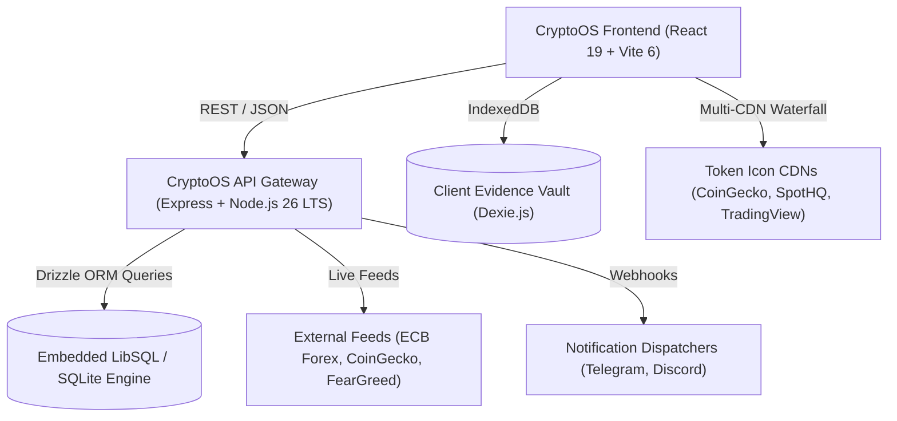

<div align="center">

# 🌌 CryptoOS
### Quantitative Trading Terminal & Market Intelligence Operating System

[](https://www.typescriptlang.org/)
[](https://react.dev/)
[](https://vitejs.dev/)
[](https://nodejs.org/)
[](https://www.sqlite.org/)
[](LICENSE.md)

<p align="center">
  <strong>A private, Bloomberg Terminal-grade crypto intelligence engine, macro cycle workstation, asymmetric risk sizer, behavioral journal, and autonomous disaster recovery vault.</strong>
</p>

### ⚡ Commercial & Services Gateway
<p align="center">
  <a href="mailto:ilhamgb11@gmail.com?subject=[CryptoOS]%20Live%20Demo%20%26%20Walkthrough%20Request"><strong>[ 🔴 Request Live Demo & Access ]</strong></a>
  &nbsp;&bull;&nbsp;
  <a href="#-layanan--kustomisasi-hire-the-author"><strong>[ 💼 Sewa Jasa (Hire the Author) ]</strong></a>
  &nbsp;&bull;&nbsp;
  <a href="#-lisensi-komersial--pembelian-source-code"><strong>[ 🛒 Beli Lisensi Komersial ]</strong></a>
</p>

[Key Features](#-key-capabilities) •
[Architecture](#-architectural-overview) •
[Quickstart](#-quickstart-guide) •
[Modules](#-core-terminal-modules) •
[API Specification](#-api-endpoints) •
[Commercial License](#-lisensi-komersial--pembelian-source-code) •
[Hire the Author](#-layanan--kustomisasi-hire-the-author) •
[License](#-lisensi--hak-cipta)

</div>

---

## 🌟 Executive Overview

**CryptoOS** is an institutional-grade, personal quantitative trading terminal engineered to replace fragmented browser tabs with a unified, high-performance financial command center.

Built with an unapologetic **Cardless Pure Black (`#000000`) OLED** design language, CryptoOS provides real-time macroeconomic synthesis, multi-timeframe trade ideation, mathematical lot sizing via the **Half-Kelly Criterion**, early liquidation defense, behavioral psychology journaling, and **self-contained disaster recovery snapshots**.

---

## ⚡ Key Capabilities

### 1. 🌐 Global Macro Intel & Fed Watch Engine
* **Federal Reserve Interest Rate Monitor**: Real-time gauge of rate hike/cut probabilities with institutional visual indicators.
* **Capital Rotation & Dominance Radar**: Live telemetry tracking BTC Dominance (`BTC.D`), Stablecoin Flow (`USDT.D`), and Altcoin Market Cap (`TOTAL3`).
* **Fear & Greed Sentiment Meter**: Historical and real-time sentiment telemetry to spot asymmetric market tops and bottoms.
* **Dual Currency Engine**: Seamless real-time conversion between US Dollar (`USD`) and Indonesian Rupiah (`IDR`) backed by live ECB forex feeds.

### 2. 🧪 Pipeline & Quantitative Idea Incubator
* **Floating Glass Capsule HUD**: Centered, distraction-free floating telemetry pill showing active pipeline statistics, total potential reward, and aggregate risk.
* **Multi-Timeframe Trade Canvas**: High-contrast cards for drafting setups (HTF 1W/1D down to 4H/15m) with asymmetric Risk:Reward telemetry.
* **One-Click Calculator Transfer**: Seamlessly bridge pipeline setups into the Risk Sizer without re-entering parameters.

### 3. 🛡️ Position Sizer & Kelly Defense Engine
* **Dynamic Multi-CDN Token Engine**: Auto-resolves verified official logos for any cryptocurrency (over 500+ tokens) with fallback waterfalls and deterministic avatars.
* **Mathematical Risk-Neutral Lot Sizing**: Calculates exact lot sizes in coins and fiat to strictly enforce a pre-set risk tolerance percentage.
* **Interactive Liquidation Safety Gauge**: Tri-color visual track displaying the safety margin between Stop Loss and Liquidation threshold.
* **Half-Kelly Criterion Sizer**: Interactive win-rate simulator that recommends optimal capital allocation to maximize geometric capital growth without risk of ruin.
* **Direct Journal Dispatch**: Single-click button that populates the setup directly into the Trade Journal.

### 4. 📓 Behavioral Trade Journal & Evidence Locker
* **Execution & Psychology Tracking**: Logs emotional states (`Calm`, `FOMO`, `Anxious`, `Revenge`) alongside trade entries.
* **IndexedDB Screenshot Evidence Vault**: Attach chart screenshots directly to trades without third-party image hosting vulnerabilities.
* **Real-Time PnL Realization**: Interactive trade close modal with automated net PnL calculations and lesson capture.
* **Psychological Discipline Matrix**: Quantifies emotional capital leaks vs disciplined alpha performance.

### 5. 🔐 Autonomous Disaster Recovery & Data Vault
* **Per-User Isolated Master Backup**: Generates complete `.json` cryptographic snapshot archives bundling trade entries, cashflow mutations, trade ideas, spot holdings, and local terminal preferences.
* **Pre-Flight Archive Verification Inspector**: Validates file integrity, checksum, and records before applying changes.
* **Flexible Restoration Strategy**: Supports both **Merge (Append)** and **Clean Rebuild (Overwrite)** restore modes.
* **Automated Browser Snapshot Cache**: Client-side backup cache that updates silently when positions are logged.

### 6. 🔔 Realtime Notification Webhook Bridges
* **Telegram Bot Dispatcher**: Dispatches trade entries, take-profit hits, stop-loss triggers, and drawdown warnings to private Telegram chats.
* **Discord Webhook Sentinel**: Broadcasts rich embedded trade updates into dedicated Discord channels.
* **Active Event Triggers Matrix**: Granular toggles for Trade Executions, Circuit Breaker Breaches, Portfolio Allocation Drift, and Whale Cashflow Mutations (> $1,000 USD).

### 7. 📑 Tax-Ready Accounting CSV Exporters
* **1-Click CSV Ledger Generation**: Dedicated export engines for Trading Journal Ledger, Treasury Cashflow, and Spot Holdings.
* **Universal Software Compatibility**: Formatted with UTF-8 BOM encoding for seamless opening in Microsoft Excel, Koinly, and CoinTracker.

---

## 🏛️ Architectural Overview

CryptoOS is structured as a clean, modular TypeScript monorepo orchestrated via **npm workspaces**:



---

## 💻 Tech Stack

| Layer | Technology | Rationale |
| :--- | :--- | :--- |
| **Frontend Framework** | **React 19** + **Vite 6** | Instant HMR, lightweight bundle size, and concurrent rendering features. |
| **Language** | **TypeScript 5.7+** | End-to-end strict type-safety across shared domain interfaces. |
| **Design System** | **Vanilla CSS (Design Tokens)** | Zero bloated utility libraries; bespoke Cardless Pure Black `#000000` OLED aesthetic. |
| **Icons & Media** | **Lucide React** + **Multi-CDN Waterfall** | Clean terminal iconography and dynamic crypto logo resolution. |
| **Backend Runtime** | **Node.js 26 LTS** + **Express 4** | Ultra-stable, high-performance runtime with latest security patches. |
| **Database & ORM** | **Drizzle ORM** + **@libsql/client** | Embedded, zero-ops, file-based SQL database with ACID compliance and WAL mode. |
| **Client Storage** | **IndexedDB** (`Dexie.js`) | Local storage of heavy trade screenshot files without remote server costs. |

---

## 🚀 Quickstart Guide

> [!IMPORTANT]
> **Evaluation & Demo Notice (`LICENSE.md`)**  
> Menjalankan repositori ini di lingkungan lokal diberikan secara eksklusif untuk kebutuhan **evaluasi teknis, pengujian fitur, pembelajaran, dan peninjauan arsitektur sistem**.  
> Seluruh kode sumber tunduk pada ketentuan [LICENSE.md](LICENSE.md) dan **dilarang keras** digunakan untuk operasional produksi (*production deployment*), tujuan komersial, di-*white-label*, atau didistribusikan ulang tanpa izin resmi atau [Lisensi Komersial](#-lisensi-komersial--pembelian-source-code) dari pemilik hak cipta.

### System Requirements
* **Node.js**: `v26.0.0` or higher (Active LTS recommended)
* **NPM**: `v11.0.0` or higher
* **Git**: `2.30+`

### 1. Clone the Repository
```bash
git clone https://github.com/your-username/cryptoos.git
cd cryptoos
```

### 2. Install Dependencies
```bash
npm install
```
> *This command installs dependencies for root, backend, and frontend concurrently using npm workspaces.*

### 3. Configure Environment Variables
Copy `.env.example` to `.env`:

```bash
# Linux / macOS
cp .env.example .env

# Windows (PowerShell)
Copy-Item .env.example .env
```

Default configuration in `.env`:
```env
PORT=3001
CORS_ORIGIN=http://localhost:5173
DATABASE_PATH=./data/cryptoos.db
VITE_GOOGLE_CLIENT_ID=your-google-oauth-client-id.apps.googleusercontent.com
```

### 4. Start Development Servers
Run both backend and frontend with a single command:
```bash
npm run dev
```

* 🌐 **Terminal Frontend**: [http://localhost:5173](http://localhost:5173)
* 🔌 **Backend Health Check**: [http://localhost:3001/api/health](http://localhost:3001/api/health)
* 📊 **Market Intel Feed**: [http://localhost:3001/api/market/intel](http://localhost:3001/api/market/intel)

---

## 📂 Project Directory Structure

```text
CryptoOS/
├── .github/                     # GitHub Actions CI & Community Templates
│   ├── workflows/ci.yml         # Automated Lint & TypeScript typechecking
│   ├── ISSUE_TEMPLATE/          # Structured Bug & Feature issue templates
│   └── pull_request_template.md # Standardized PR review checklist
├── backend/                     # Express REST API Server (Node.js 26 LTS)
│   ├── src/
│   │   ├── modules/             # Modular Domain Services
│   │   │   ├── auth/            # JWT authentication & session management
│   │   │   ├── market/          # Macro intel, ECB forex & CoinGecko proxies
│   │   │   ├── ideas/           # 4-Pillars swing trade incubator
│   │   │   ├── journal/         # Trade execution & psychology post-mortem
│   │   │   ├── portfolio/       # Spot portfolio allocations & rebalancing
│   │   │   ├── cashflow/        # Treasury inflow/outflow ledger
│   │   │   └── settings/        # Disaster recovery backup engine & webhooks
│   │   ├── db/                  # Drizzle ORM schema & LibSQL client setup
│   │   ├── middleware/          # JWT auth, error handling & security middleware
│   │   └── server.ts            # Application bootstrapper
│   └── tsconfig.json
├── docs/                        # Deep-dive architecture & engineering specs
│   ├── API_SPEC.md              # Complete REST API specification
│   ├── ARCHITECTURE.md          # System design & component diagrams
│   ├── DEPLOYMENT_GUIDE.md      # VPS & production deployment handbook
│   ├── DESIGN.md                # Cardless Pure Black design tokens & guidelines
│   └── PRD.md                   # Product Requirements Document
├── frontend/                    # Vite 6 + React 19 Client
│   ├── src/
│   │   ├── components/          # Reusable UI widgets & TokenIcon resolver
│   │   ├── pages/               # Dashboard, Pipeline, Calculator, Journal, Settings
│   │   ├── services/            # Axios API client & Dexie IndexedDB client
│   │   ├── store/               # Zustand state stores (Settings, Auth, Rates)
│   │   ├── types/               # TypeScript domain interfaces
│   │   ├── utils/               # Math calculations & UTF-8 BOM CSV exporters
│   │   └── index.css            # OLED design tokens & global typography
│   └── vite.config.ts
├── package.json                 # Monorepo workspaces manifest (Node.js 26+ engine)
└── README.md                    # Institutional Project Documentation
```

---

## 🔌 API Endpoints Summary

| Method | Endpoint | Description |
| :--- | :--- | :--- |
| `GET` | `/api/health` | System health check and uptime telemetry. |
| `GET` | `/api/market/intel` | Aggregated market data: Fed watch, dominance, sentiment. |
| `GET` | `/api/ideas` | Retrieve active trade pipeline incubator setups. |
| `POST` | `/api/ideas` | Save a new quantitative trade idea with SL/TP targets. |
| `GET` | `/api/journal/trades` | Fetch complete trading journal execution ledger. |
| `POST` | `/api/journal/trades` | Log a new trade position entry. |
| `POST` | `/api/journal/trades/:id/close` | Close trade position, compute realized PnL, and log lessons. |
| `GET` | `/api/portfolio/summary` | Retrieve spot asset allocations and target drift. |
| `GET` | `/api/cashflow` | Fetch capital liquidity ledger (deposits, yields, withdrawals). |
| `GET` | `/api/settings/backup/export` | Export per-user master disaster recovery snapshot archive (.json). |
| `POST` | `/api/settings/backup/import` | Atomic database restore with Merge or Clean Rebuild modes. |
| `POST` | `/api/settings/webhook/telegram` | Dispatch test ping to private Telegram bot chat. |
| `POST` | `/api/settings/webhook/discord` | Dispatch test embed to Discord channel webhook. |

---

## 🎨 Design Philosophy: Cardless Pure Black OLED

CryptoOS adheres strictly to **Emil Kowalski's Design Engineering** and modern Apple interface principles:
1. **Zero Grey Container Clutter**: We eliminate unnecessary heavy box outlines in favor of seamless horizontal dividing hairlines and grouped inset surfaces.
2. **Pure Black Ground (`#000000`)**: Minimizes eye strain during multi-hour trading sessions and provides infinite contrast on OLED displays.
3. **Restrained Color Hierarchy**:
   * **Terminal Gold (`#D4AF37`)**: Primary brand identity and key focus metrics.
   * **Bullish Emerald (`#10B981`)**: Long positions, positive return, and safety buffers.
   * **Bearish Rose (`#F43F5E`)**: Short positions, stop losses, and danger thresholds.
   * **Tabular JetBrains Mono**: Financial numerals rendered in fixed-width tabular numbers for instantaneous column scanning.

---

## 🤝 Contributing

We welcome contributions from quantitative analysts, traders, and software engineers!

1. Read our [Contributing Guidelines](CONTRIBUTING.md).
2. Follow our [Code of Conduct](CODE_OF_CONDUCT.md).
3. Fork the repository, create your branch (`git checkout -b feature/amazing-feature`), and open a Pull Request using our [PR Template](.github/pull_request_template.md).

---

## 💼 Layanan & Kustomisasi (Hire the Author)

Apakah Anda, *trading firm*, atau institusi Anda membutuhkan platform analitik quantitative kustom, terminal eksekusi trading proprietary, atau integrasi data pasar real-time berkinerja tinggi?

Sebagai Lead Architect dan pengembang dari **CryptoOS**, saya (**Ilham Rizanto**) menyediakan jasa rekayasa perangkat lunak finansial profesional (*bespoke development & consulting*):

### Portfolio Keahlian & Penawaran Jasa:
* **Custom Quantitative Terminal Development**: Membangun antarmuka dashboard analitik dengan standar institusional (Pure Black `#000000` OLED, Zero-Clutter Architecture, dual-currency real-time rates).
* **Exchange Connectivity & Algorithmic Bridges**: Integrasi koneksi read-only atau automated trade execution via REST & WebSocket (Binance, Bybit, OKX, Hyperliquid, DEX protocols) dengan standar *zero-withdrawal security*.
* **Risk Engine & Mathematical Sizing**: Implementasi kalkulator Kelly Criterion, Dynamic Stop-Loss trailing, Liquidation buffer alerts, dan Portfolio Drift Balancer.
* **Macro Telemetry & Data Aggregation**: Pipeline otomatis penarik data Federal Reserve (FRED), sentimen Fear & Greed, likuiditas stablecoin, dan rasio dominasi.
* **Notification Bridges**: Bot Telegram institusional dan Discord Webhook Dispatcher dengan format rich-embed & latency rendah.
* **Architecture Consultation & Code Review**: Audit keamanan stack React 19 / Node.js 26 LTS / SQLite LibSQL, optimasi query, dan perencanaan *zero-ops disaster recovery vault*.

> 📬 **Mulai Diskusi Proyek:**  
> Untuk konsultasi kebutuhan teknis, proposal proyek, atau kustomisasi fitur, hubungi langsung melalui email:  
> **👉 [ilhamgb11@gmail.com](mailto:ilhamgb11@gmail.com?subject=[CryptoOS]%20Consulting%20%26%20Custom%20Development%20Inquiry)**

---

## 🛒 Lisensi Komersial & Pembelian Source Code

Repositori publik ini dirilis di bawah skema lisensi **Source-Available Evaluation & Demo License** (khusus pengujian lokal dan evaluasi arsitektur). Apabila Anda ingin mengadopsi atau meluncurkan CryptoOS untuk tujuan bisnis, tersedia dua pilihan skema lisensi komersial resmi:

### 1. Commercial Standard License (Non-Exclusive)
*Pilihan ideal bagi Startup Fintech, Prop Firm, Crypto Hedge Fund, atau Komunitas Trading yang membutuhkan sistem siap pakai untuk operasional internal atau produk klien.*
* **Hak Penggunaan**: Izin legal non-eksklusif untuk mengompilasi, men-deploy, dan mengoperasikan CryptoOS pada 1 (satu) entitas bisnis atau proyek komersial.
* **White-Labeling & Rebranding**: Bebas menghapus atau mengganti nama, logo, skema warna, dan branding sistem sesuai merek Anda.
* **Akses Source Code Penuh**: Menyerahkan repositori lengkap (Backend Node.js 26 + Frontend React 19 Vite) tanpa proteksi DRM atau obfuscation.
* **Dukungan Awal**: 14 hari bantuan teknis instalasi dan konfigurasi deployment server (Docker/VPS/Nginx).

### 2. Full IP & Code Buyout (Exclusive Ownership)
*Pilihan tepat bagi Korporasi, Venture Capital, atau Investor yang ingin mengakuisisi kepemilikan aset intelektual penuh untuk dijadikan produk SaaS berbayar atau dipatenkan.*
* **Pengalihan Hak Cipta Mutlak (*IP Assignment*)**: Pengalihan penuh hak kekayaan intelektual atas nama pembeli secara legal.
* **Hak Komersialisasi Tanpa Batas**: Hak untuk menjual ulang (*resell*), melisensikan kembali (*sublicense*), merilis varian SaaS berbayar, atau memodifikasi tanpa batasan apa pun.
* **Penyerahan Total**: Seluruh riwayat komit git, master branch, desain token arsitektur, dan dokumentasi internal diserahkan secara privat dan eksklusif.
* **Sesi Handover & Mentoring**: Workshop transfer arsitektur 1-on-1 bersama Lead Architect untuk onboarding tim engineering internal Anda.

---

### 📩 Prosedur Pembelian Lisensi:
Kirimkan surat permohonan lisensi resmi ke:
* **Kontak**: **[ilhamgb11@gmail.com](mailto:ilhamgb11@gmail.com?subject=[CryptoOS]%20Commercial%20License%20Inquiry)**
* **Subjek**: `[CryptoOS] Commercial License Inquiry - [Nama Perusahaan / Inisial Anda]`
* **Format Pesan**: Cantumkan skema lisensi yang diinginkan (*Standard* atau *Full IP Buyout*) beserta gambaran singkat skala penerapan sistem Anda.

---

## 📄 Lisensi & Hak Cipta

**Copyright (c) 2026 Ilham Rizanto. All rights reserved.**

Seluruh hak cipta dan kepemilikan intelektual atas kode sumber, arsitektur sistem, dan materi desain **CryptoOS** adalah sah milik **Ilham Rizanto**.

Repositori ini berstatus *source-available* secara ketat untuk kebutuhan evaluasi, review kode, demonstrasi arsitektur, dan pengujian personal. Dilarang keras menggunakan sebagian atau seluruh isi repositori ini dalam lingkungan produksi, memperjualbelikan, melisensikan kembali, atau mengklaim kepemilikan tanpa perjanjian lisensi tertulis dari pemilik hak cipta.

Untuk ketentuan hukum selengkapnya, silakan merujuk pada berkas [LICENSE.md](LICENSE.md).

<div align="center">
  <sub>Architected with institutional rigor, quantitative discipline, and uncompromised financial sovereignty.</sub>
</div>

