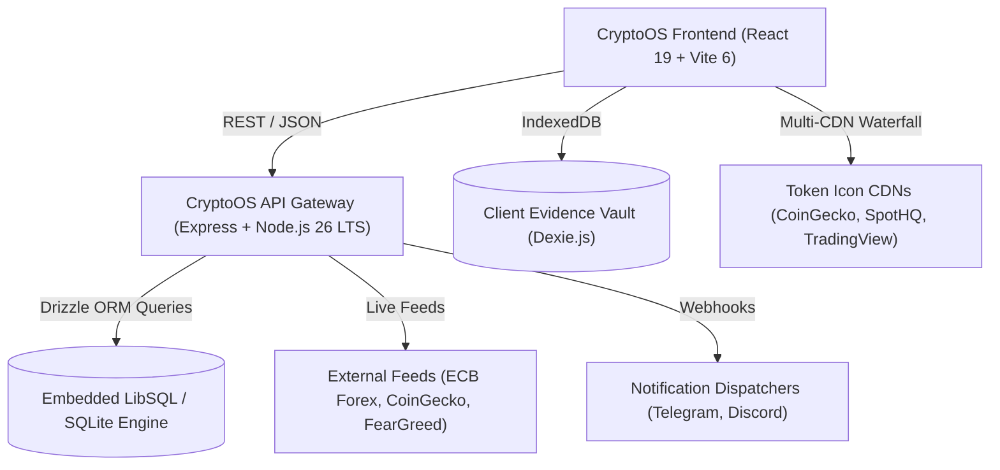

<div align="center">

# 🌌 CryptoOS
### Quantitative Trading Terminal & Market Intelligence Operating System

[](https://www.typescriptlang.org/)
[](https://react.dev/)
[](https://vitejs.dev/)
[](https://nodejs.org/)
[](https://www.sqlite.org/)
[](LICENSE.md)

<p align="center">
  <strong>A private, Bloomberg Terminal-grade crypto intelligence engine, macro cycle workstation, asymmetric risk sizer, behavioral journal, and autonomous disaster recovery vault.</strong>
</p>

### ⚡ Commercial & Services Gateway
<p align="center">
  <a href="mailto:ilhamgb11@gmail.com?subject=[CryptoOS]%20Live%20Demo%20%26%20Walkthrough%20Request"><strong>[ 🔴 Request Live Demo & Access ]</strong></a>
  &nbsp;&bull;&nbsp;
  <a href="#-custom-development--consulting-hire-the-author"><strong>[ 💼 Hire the Author (Custom Development) ]</strong></a>
  &nbsp;&bull;&nbsp;
  <a href="#-commercial-licensing--code-buyout"><strong>[ 🛒 Commercial Licensing & Buyout ]</strong></a>
</p>

[Key Features](#-key-capabilities) •
[Architecture](#-architectural-overview) •
[Quickstart](#-quickstart-guide) •
[Modules](#-core-terminal-modules) •
[API Specification](#-api-endpoints) •
[Commercial Licensing](#-commercial-licensing--code-buyout) •
[Hire the Author](#-custom-development--consulting-hire-the-author) •
[License & Copyright](#-license--copyright-notice)

</div>

---

## 🌟 Executive Overview

**CryptoOS** is an institutional-grade, personal quantitative trading terminal engineered to replace fragmented browser tabs with a unified, high-performance financial command center.

Built with an unapologetic **Cardless Pure Black (`#000000`) OLED** design language, CryptoOS provides real-time macroeconomic synthesis, multi-timeframe trade ideation, mathematical lot sizing via the **Half-Kelly Criterion**, early liquidation defense, behavioral psychology journaling, and **self-contained disaster recovery snapshots**.

---

## ⚡ Key Capabilities

### 1. 🌐 Global Macro Intel & Fed Watch Engine
* **Federal Reserve Interest Rate Monitor**: Real-time gauge of rate hike/cut probabilities with institutional visual indicators.
* **Capital Rotation & Dominance Radar**: Live telemetry tracking BTC Dominance (`BTC.D`), Stablecoin Flow (`USDT.D`), and Altcoin Market Cap (`TOTAL3`).
* **Fear & Greed Sentiment Meter**: Historical and real-time sentiment telemetry to spot asymmetric market tops and bottoms.
* **Dual Currency Engine**: Seamless real-time conversion between US Dollar (`USD`) and Indonesian Rupiah (`IDR`) backed by live ECB forex feeds.

### 2. 🧪 Pipeline & Quantitative Idea Incubator
* **Floating Glass Capsule HUD**: Centered, distraction-free floating telemetry pill showing active pipeline statistics, total potential reward, and aggregate risk.
* **Multi-Timeframe Trade Canvas**: High-contrast cards for drafting setups (HTF 1W/1D down to 4H/15m) with asymmetric Risk:Reward telemetry.
* **One-Click Calculator Transfer**: Seamlessly bridge pipeline setups into the Risk Sizer without re-entering parameters.

### 3. 🛡️ Position Sizer & Kelly Defense Engine
* **Dynamic Multi-CDN Token Engine**: Auto-resolves verified official logos for any cryptocurrency (over 500+ tokens) with fallback waterfalls and deterministic avatars.
* **Mathematical Risk-Neutral Lot Sizing**: Calculates exact lot sizes in coins and fiat to strictly enforce a pre-set risk tolerance percentage.
* **Interactive Liquidation Safety Gauge**: Tri-color visual track displaying the safety margin between Stop Loss and Liquidation threshold.
* **Half-Kelly Criterion Sizer**: Interactive win-rate simulator that recommends optimal capital allocation to maximize geometric capital growth without risk of ruin.
* **Direct Journal Dispatch**: Single-click button that populates the setup directly into the Trade Journal.

### 4. 📓 Behavioral Trade Journal & Evidence Locker
* **Execution & Psychology Tracking**: Logs emotional states (`Calm`, `FOMO`, `Anxious`, `Revenge`) alongside trade entries.
* **IndexedDB Screenshot Evidence Vault**: Attach chart screenshots directly to trades without third-party image hosting vulnerabilities.
* **Real-Time PnL Realization**: Interactive trade close modal with automated net PnL calculations and lesson capture.
* **Psychological Discipline Matrix**: Quantifies emotional capital leaks vs disciplined alpha performance.

### 5. 🔐 Autonomous Disaster Recovery & Data Vault
* **Per-User Isolated Master Backup**: Generates complete `.json` cryptographic snapshot archives bundling trade entries, cashflow mutations, trade ideas, spot holdings, and local terminal preferences.
* **Pre-Flight Archive Verification Inspector**: Validates file integrity, checksum, and records before applying changes.
* **Flexible Restoration Strategy**: Supports both **Merge (Append)** and **Clean Rebuild (Overwrite)** restore modes.
* **Automated Browser Snapshot Cache**: Client-side backup cache that updates silently when positions are logged.

### 6. 💼 Multi-Exchange Spot Portfolio & Treasury Gateway
* **10 Supported Exchanges with Live Ping Telemetry**: Consolidate holdings and cashflow across Tier-1 Global platforms (**Binance**, **Bybit**, **OKX**, **MEXC**, **KuCoin**, **Gate.io**, **Bitget**) and Bappebti-Regulated Indonesian fiat gateways (**Indodax**, **Tokocrypto**, **Triv**), alongside Cold Storage (Ledger/Trezor).
* **Strict Zero-Knowledge & Zero-Withdrawal Security**: Read-only API credentials remain strictly inside your browser sandbox (`localStorage`). Withdrawal permissions are strictly unsupported.
* **Real-time Latency & HMAC Telemetry**: Test gateway connectivity and round-trip ping with HMAC signature authentication verification.
* **Multi-Vault Cashflow Mutations**: Track capital injections and treasury transfers indexed by specific destination exchange vaults.

### 7. 🔔 Realtime Notification Webhook Bridges
* **Telegram Bot Dispatcher**: Dispatches trade entries, take-profit hits, stop-loss triggers, and drawdown warnings to private Telegram chats.
* **Discord Webhook Sentinel**: Broadcasts rich embedded trade updates into dedicated Discord channels.
* **Active Event Triggers Matrix**: Granular toggles for Trade Executions, Circuit Breaker Breaches, Portfolio Allocation Drift, and Whale Cashflow Mutations (> $1,000 USD).

### 8. 📑 Tax-Ready Accounting CSV Exporters
* **1-Click CSV Ledger Generation**: Dedicated export engines for Trading Journal Ledger, Treasury Cashflow, and Spot Holdings.
* **Universal Software Compatibility**: Formatted with UTF-8 BOM encoding for seamless opening in Microsoft Excel, Koinly, and CoinTracker.

---

## 🏛️ Architectural Overview

CryptoOS is structured as a clean, modular TypeScript monorepo orchestrated via **npm workspaces**:



---

## 💻 Tech Stack

| Layer | Technology | Rationale |
| :--- | :--- | :--- |
| **Frontend Framework** | **React 19** + **Vite 6** | Instant HMR, lightweight bundle size, and concurrent rendering features. |
| **Language** | **TypeScript 5.7+** | End-to-end strict type-safety across shared domain interfaces. |
| **Design System** | **Vanilla CSS (Design Tokens)** | Zero bloated utility libraries; bespoke Cardless Pure Black `#000000` OLED aesthetic. |
| **Icons & Media** | **Lucide React** + **Multi-CDN Waterfall** | Clean terminal iconography and dynamic crypto logo resolution. |
| **Backend Runtime** | **Node.js 26 LTS** + **Express 4** | Ultra-stable, high-performance runtime with latest security patches. |
| **Database & ORM** | **Drizzle ORM** + **@libsql/client** | Embedded, zero-ops, file-based SQL database with ACID compliance and WAL mode. |
| **Client Storage** | **IndexedDB** (`Dexie.js`) | Local storage of heavy trade screenshot files without remote server costs. |

---

## 🚀 Quickstart Guide

> [!IMPORTANT]
> **Evaluation & Demo Notice (`LICENSE.md`)**  
> Running this repository locally is permitted strictly for **technical evaluation, feature testing, educational review, and architectural assessment**.  
> The entire codebase is governed by [LICENSE.md](LICENSE.md) and is **strictly prohibited** from production deployment, commercial operation, white-labeling, or unauthorized redistribution without obtaining a written commercial agreement or an official [Commercial License](#-commercial-licensing--code-buyout) from the copyright holder ([Ilham Rizanto](mailto:ilhamgb11@gmail.com)).

### System Requirements
* **Node.js**: `v26.0.0` or higher (Active LTS recommended)
* **NPM**: `v11.0.0` or higher
* **Git**: `2.30+`
### 1. Clone the Repository
```bash
git clone https://github.com/ilhamrizanto/CryptoOS.git
cd CryptoOS
```

### 2. Install Dependencies
```bash
npm install
```
> *This command installs dependencies for root, backend, and frontend concurrently using npm workspaces.*

### 3. Configure Environment Variables
Copy `.env.example` to `.env`:

```bash
# Linux / macOS
cp .env.example .env

# Windows (PowerShell)
Copy-Item .env.example .env
```

Default configuration in `.env`:
```env
PORT=3001
CORS_ORIGIN=http://localhost:5173
DATABASE_PATH=./data/cryptoos.db
VITE_GOOGLE_CLIENT_ID=your-google-oauth-client-id.apps.googleusercontent.com
```

### 4. Start Development Servers
Run both backend and frontend with a single command:
```bash
npm run dev
```

* 🌐 **Terminal Frontend**: [http://localhost:5173](http://localhost:5173)
* 🔌 **Backend Health Check**: [http://localhost:3001/api/health](http://localhost:3001/api/health)
* 📊 **Market Intel Feed**: [http://localhost:3001/api/market/intel](http://localhost:3001/api/market/intel)

---

## 🎮 Safe & Self-Healing Portfolio Demo Mode

CryptoOS includes an enterprise-grade **Portfolio Guest Demo Mode** engineered specifically for public portfolio deployments, recruiters, and prospective clients. It allows full interactive exploration of all roles and capabilities with **zero VPS resource exploitation risk** and **zero external API leakage**.

### 🌟 Key Architecture Pillars
1. **Global Configuration Toggle**: Controlled globally via `DEMO_MODE=True` in `.env` (backend) and `VITE_DEMO_MODE=True` (frontend). When enabled, all sandbox mocking and demo login endpoints are activated.
2. **1-Click Role-Based Quick Login**: The login screen (`/login`) features an institutional "Akses Demo Portofolio" instant access panel with 3 pre-configured roles:
   * 👑 **Admin / Portfolio Lead**: Full access to Whitelist management, Master Vault backups, and System Risk protocols.
   * ✍️ **Quant Trader / Operator**: Active trading execution, Trade Journal, Kelly lot sizer, and Pipeline incubation.
   * 👁️ **Client Auditor / Viewer**: Read-only oversight with strict mutation locks (`POST`/`PUT`/`DELETE` blocked).
3. **Realistic Quantitative Seed Generator**: Built-in CLI command generating realistic institutional trading records, treasury cashflows, 4-pillar setups, and multi-exchange spot balances:
   ```bash
   # Re-seed demo database with fresh baseline records
   npm run seed:demo -- --reset
   ```
4. **Zero External Abuse & Leaks Sandbox**: All outbound integrations (Telegram bot tests, Discord webhooks, CEX latency checks, and live exchange balance fetches) are intercepted in backend middleware. They return simulated success payloads without contacting real third-party APIs or exposing API keys.
5. **In-App Lazy Auto-Reset (Zero-Cron Architecture)**: Uses request-intercepting middleware (`demoAutoReset.middleware.ts`) and a `.demo_last_reset` timestamp marker. If 1 hour (3600 seconds) has elapsed since the last reset, incoming requests atomically trigger a clean re-seed with a concurrency lock—**eliminating the need for RAM-heavy VPS cron jobs or background daemons**.
6. **Self-Service Navbar "↺ Reset Demo"**: Active demo sessions display a `⚡ DEMO MODE` pill and a `[ ↺ Reset Demo ]` button in the top navigation bar. Clicking it opens a confirmation modal and triggers `POST /api/demo/reset`, restoring a fresh baseline with automatic browser reload.
7. **Ephemeral Sessions & Anti-Bloat Defense**:
   * Short 2-hour JWT expiration for demo accounts.
   * Hardened demo credentials (`user-demo-admin`, `user-demo-operator`, `user-demo-viewer`) protected against deletion or modification in User Whitelist.
   * Strict anti-bloat rate limiting capping guest record creation at a maximum of 50 entries per module.

---

## 📂 Project Directory Structure

```text
CryptoOS/
├── .github/                     # GitHub Actions CI & Community Templates
│   ├── workflows/ci.yml         # Automated Lint & TypeScript typechecking
│   ├── ISSUE_TEMPLATE/          # Structured Bug & Feature issue templates
│   └── pull_request_template.md # Standardized PR review checklist
├── backend/                     # Express REST API Server (Node.js 26 LTS)
│   ├── src/
│   │   ├── modules/             # Modular Domain Services
│   │   │   ├── auth/            # JWT authentication & session management
│   │   │   ├── market/          # Macro intel, ECB forex & CoinGecko proxies
│   │   │   ├── ideas/           # 4-Pillars swing trade incubator
│   │   │   ├── journal/         # Trade execution & psychology post-mortem
│   │   │   ├── portfolio/       # Spot portfolio allocations & rebalancing
│   │   │   ├── cashflow/        # Treasury inflow/outflow ledger
│   │   │   └── settings/        # Disaster recovery backup engine & webhooks
│   │   ├── db/                  # Drizzle ORM schema & LibSQL client setup
│   │   ├── middleware/          # JWT auth, error handling & security middleware
│   │   └── server.ts            # Application bootstrapper
│   └── tsconfig.json
├── docs/                        # Deep-dive architecture & engineering specs
│   ├── API_SPEC.md              # Complete REST API specification
│   ├── ARCHITECTURE.md          # System design & component diagrams
│   ├── DEPLOYMENT_GUIDE.md      # VPS & production deployment handbook
│   ├── DESIGN.md                # Cardless Pure Black design tokens & guidelines
│   └── PRD.md                   # Product Requirements Document
├── frontend/                    # Vite 6 + React 19 Client
│   ├── src/
│   │   ├── components/          # Reusable UI widgets & TokenIcon resolver
│   │   ├── pages/               # Dashboard, Pipeline, Calculator, Journal, Settings
│   │   ├── services/            # Axios API client & Dexie IndexedDB client
│   │   ├── store/               # Zustand state stores (Settings, Auth, Rates)
│   │   ├── types/               # TypeScript domain interfaces
│   │   ├── utils/               # Math calculations & UTF-8 BOM CSV exporters
│   │   └── index.css            # OLED design tokens & global typography
│   └── vite.config.ts
├── package.json                 # Monorepo workspaces manifest (Node.js 26+ engine)
└── README.md                    # Institutional Project Documentation
```

---

## 🔌 API Endpoints Summary

| Method | Endpoint | Description |
| :--- | :--- | :--- |
| `GET` | `/api/health` | System health check and uptime telemetry. |
| `GET` | `/api/market/intel` | Aggregated market data: Fed watch, dominance, sentiment. |
| `GET` | `/api/ideas` | Retrieve active trade pipeline incubator setups. |
| `POST` | `/api/ideas` | Save a new quantitative trade idea with SL/TP targets. |
| `GET` | `/api/journal/trades` | Fetch complete trading journal execution ledger. |
| `POST` | `/api/journal/trades` | Log a new trade position entry. |
| `POST` | `/api/journal/trades/:id/close` | Close trade position, compute realized PnL, and log lessons. |
| `GET` | `/api/portfolio/summary` | Retrieve spot asset allocations and target drift. |
| `GET` | `/api/cashflow` | Fetch capital liquidity ledger (deposits, yields, withdrawals). |
| `GET` | `/api/settings/backup/export` | Export per-user master disaster recovery snapshot archive (.json). |
| `POST` | `/api/settings/backup/import` | Atomic database restore with Merge or Clean Rebuild modes. |
| `POST` | `/api/settings/webhook/telegram` | Dispatch test ping to private Telegram bot chat. |
| `POST` | `/api/settings/webhook/discord` | Dispatch test embed to Discord channel webhook. |

---

## 🎨 Design Philosophy: Cardless Pure Black OLED

CryptoOS adheres strictly to **Emil Kowalski's Design Engineering** and modern Apple interface principles:
1. **Zero Grey Container Clutter**: We eliminate unnecessary heavy box outlines in favor of seamless horizontal dividing hairlines and grouped inset surfaces.
2. **Pure Black Ground (`#000000`)**: Minimizes eye strain during multi-hour trading sessions and provides infinite contrast on OLED displays.
3. **Restrained Color Hierarchy**:
   * **Terminal Gold (`#D4AF37`)**: Primary brand identity and key focus metrics.
   * **Bullish Emerald (`#10B981`)**: Long positions, positive return, and safety buffers.
   * **Bearish Rose (`#F43F5E`)**: Short positions, stop losses, and danger thresholds.
   * **Tabular JetBrains Mono**: Financial numerals rendered in fixed-width tabular numbers for instantaneous column scanning.

---

## 🤝 Contributing

We welcome contributions from quantitative analysts, traders, and software engineers!

1. Read our [Contributing Guidelines](CONTRIBUTING.md).
2. Follow our [Code of Conduct](CODE_OF_CONDUCT.md).
3. Fork the repository, create your branch (`git checkout -b feature/amazing-feature`), and open a Pull Request using our [PR Template](.github/pull_request_template.md).

---

---

## 💼 Custom Development & Consulting (Hire the Author)

Does your trading firm, crypto fund, prop desk, or fintech startup require a custom quantitative analytics dashboard, an institutional execution terminal, or high-performance real-time market data pipelines?

As the Lead Architect and author of **CryptoOS**, I (**Ilham Rizanto**) provide bespoke software engineering, consulting, and end-to-end implementation services:

### Core Expertise & Engineering Services:
* **Custom Quantitative Terminal Architecture**: Engineering bespoke financial intelligence workstations featuring the signature Pure Black (`#000000`) OLED aesthetic, zero-clutter layout, and real-time dual-currency rates.
* **Exchange Connectivity & Algorithmic Execution**: Read-only or automated trade execution connectivity via REST & WebSocket (Binance, Bybit, OKX, Hyperliquid, DEX protocols) adhering to strict *zero-withdrawal security* standards.
* **Risk Engine & Mathematical Sizing**: Tailored implementations of Kelly Criterion sizing, Dynamic Stop-Loss trailing logic, liquidation margin buffers, and automated portfolio rebalancing.
* **Macro Intelligence & Telemetry Pipelines**: Autonomous data aggregation engines for Federal Reserve (FRED) metrics, European Central Bank forex feeds, Fear & Greed indices, and stablecoin liquidity rotation.
* **Realtime Notification Bridges**: Institutional Telegram bots and Discord Webhook dispatchers with low latency and structured embed payloads.
* **Architecture Hardening & Code Reviews**: Comprehensive performance, concurrency, and security audits across modern full-stack architectures (React 19, TypeScript, Node.js 26 LTS, LibSQL/SQLite, and zero-ops disaster recovery vaults).

> 📬 **Start a Project Discussion:**  
> To discuss your technical scope, project timeline, or custom feature requirements, reach out directly via email:  
> **👉 [ilhamgb11@gmail.com](mailto:ilhamgb11@gmail.com?subject=[CryptoOS]%20Consulting%20%26%20Custom%20Development%20Inquiry)**

---

## 🛒 Commercial Licensing & Code Buyout

This public repository is distributed under a **Source-Available Evaluation & Demo License** (strictly for local testing and architectural review). Organizations, prop firms, or investment funds wishing to commercially deploy, white-label, or build upon the CryptoOS platform can acquire an official commercial license under two flexible models:

### 1. Commercial Standard License (Non-Exclusive)
*Ideal for: Fintech startups, prop firms, hedge funds, or private trading communities seeking a production-ready institutional operating system for internal operations or client-facing value.*
* **Commercial Rights**: Non-exclusive legal license to build, deploy, and operate CryptoOS for 1 (one) business entity or commercial project.
* **White-Labeling & Custom Branding**: Full authorization to rebrand, customize typography/logos, adapt visual color schemes, and host on your private corporate domains.
* **Full Production Source Code**: Complete unminified source code (Express Node.js 26 backend + React 19 Vite frontend) with zero DRM, licensing dongles, or obfuscation.
* **Deployment Support**: 14 days of dedicated technical onboarding and server configuration guidance (Docker, VPS, Nginx, SSL).

### 2. Full IP & Code Buyout (Exclusive Ownership)
*Ideal for: Financial corporations, venture capital funds, or acquisitions seeking complete and exclusive ownership of the intellectual property to launch proprietary global SaaS products or file patent claims.*
* **Absolute IP Assignment**: Complete, legally binding assignment of all copyrights, trademarks, and intellectual property directly to the acquiring organization.
* **Unrestricted Commercialization**: Full legal rights to resell, sublicense, distribute as proprietary closed-source SaaS, or modify the technology without any restrictions.
* **Complete Asset Transfer**: Full git commit history, private repository transfers, architecture design tokens, and comprehensive internal engineering documentation.
* **Architectural Mentoring**: In-depth 1-on-1 handover workshop and engineering mentorship directly with the Lead Architect for your engineering team.

---

### 📩 Commercial Inquiries & Procurement:
Submit your formal license acquisition request to:
* **Contact**: **[ilhamgb11@gmail.com](mailto:ilhamgb11@gmail.com?subject=[CryptoOS]%20Commercial%20License%20Inquiry)**
* **Subject**: `[CryptoOS] Commercial License Inquiry - [Your Organization / Name]`
* **Message Details**: Specify your preferred license model (*Standard* or *Full IP Buyout*) and a brief outline of your target implementation scale.

---

## 📄 License & Copyright Notice

**Copyright (c) 2026 Ilham Rizanto. All rights reserved.**

All intellectual property, proprietary software architecture, design systems, and source code of **CryptoOS** are the exclusive property of **Ilham Rizanto**.

This software is distributed under a *source-available* model strictly for evaluation, testing, educational review, and demonstration purposes as outlined in [LICENSE.md](LICENSE.md). Any unauthorized commercial exploitation, production deployment, sublicensing, white-labeling, or copyright removal is strictly prohibited by law.

For complete legal terms and conditions, please consult [LICENSE.md](LICENSE.md).

<div align="center">
  <sub>Architected with institutional rigor, quantitative discipline, and uncompromised financial sovereignty.</sub>
</div>

