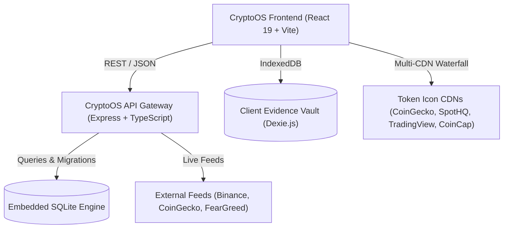

<div align="center">

# 🌌 CryptoOS
### Quantitative Trading Terminal & Market Intelligence Operating System

[](https://www.typescriptlang.org/)
[](https://react.dev/)
[](https://vitejs.dev/)
[](https://nodejs.org/)
[](https://www.sqlite.org/)
[](LICENSE)

<p align="center">
  <strong>A private, Bloomberg Terminal-grade crypto intelligence engine, macro cycle workstation, asymmetric risk sizer, and psychological trade journal.</strong>
</p>

[Key Features](#-key-capabilities) •
[Architecture](#-architectural-overview) •
[Quickstart](#-quickstart-guide) •
[Modules](#-core-terminal-modules) •
[API Specification](#-api-endpoints) •
[Contributing](#-contributing) •
[License](#-license)

</div>

---

## 🌟 Executive Overview

**CryptoOS** is an institutional-grade, personal quantitative trading terminal engineered to replace fragmented browser tabs with a unified, high-performance financial command center. 

Built with an unapologetic **Cardless Pure Black (`#000000`) OLED** design language, CryptoOS provides real-time macroeconomic synthesis, multi-timeframe trade ideation, mathematical lot sizing via the **Half-Kelly Criterion**, early liquidation defense, and behavioral psychology journaling.

---

## ⚡ Key Capabilities

### 1. 🌐 Global Macro Intel & Fed Watch Engine
* **Federal Reserve Interest Rate Monitor**: Real-time gauge of rate hike/cut probabilities with institutional visual indicators.
* **Capital Rotation & Dominance Radar**: Live telemetry tracking BTC Dominance (`BTC.D`), Stablecoin Flow (`USDT.D`), and Altcoin Market Cap (`TOTAL3`).
* **Fear & Greed Sentiment Meter**: Historical and real-time sentiment telemetry to spot asymmetric market tops and bottoms.
* **Dual Currency Engine**: Seamless real-time conversion between US Dollar (`USD`) and Indonesian Rupiah (`IDR`) across all portfolio metrics.

### 2. 🧪 Pipeline & Quantitative Idea Incubator
* **Floating Glass Capsule HUD**: Centered, distraction-free floating telemetry pill showing active pipeline statistics, total potential reward, and aggregate risk.
* **Multi-Timeframe Trade Canvas**: High-contrast cards for drafting setups (HTF 1W/1D down to 4H/15m) with asymmetric Risk:Reward telemetry.
* **One-Click Calculator Transfer**: Seamlessly bridge pipeline setups into the Risk Sizer without re-entering parameters.

### 3. 🛡️ Position Sizer & Kelly Defense Engine
* **Dynamic Multi-CDN Token Engine**: Auto-resolves verified official logos for any cryptocurrency (over 500+ tokens) with fallback waterfalls and deterministic avatars.
* **Mathematical Risk-Neutral Lot Sizing**: Calculates exact lot sizes in coins and fiat to strictly enforce a pre-set risk tolerance percentage.
* **Interactive Liquidation Safety Gauge**: Tri-color visual track displaying the safety margin between Stop Loss and Liquidation threshold.
* **Half-Kelly Criterion Sizer**: Interactive win-rate simulator that recommends optimal capital allocation to maximize geometric capital growth without risk of ruin.
* **Direct Journal Dispatch**: Single-click button that populates the setup directly into the Trade Journal.

### 4. 📓 Behavioral Trade Journal & Evidence Locker
* **Execution & Psychology Tracking**: Logs emotional state (`Calm`, `FOMO`, `Anxious`, `Revenge`) alongside trade entries.
* **IndexedDB Screenshot Evidence Vault**: Attach chart screenshots directly to trades without third-party image hosting vulnerabilities.
* **Real-Time PnL Realization**: Interactive trade close modal with automated net PnL calculations and lesson capture.

---

## 🏛️ Architectural Overview

CryptoOS is structured as a clean, modular TypeScript monorepo orchestrated via **npm workspaces**:



---

## 💻 Tech Stack

| Layer | Technology | Rationale |
| :--- | :--- | :--- |
| **Frontend Framework** | **React 19** + **Vite 6** | Instant HMR, lightweight bundle size, and concurrent rendering features. |
| **Language** | **TypeScript 5.5+** | End-to-end strict type-safety across shared domain interfaces. |
| **Design System** | **Vanilla CSS (Design Tokens)** | Zero bloated utility libraries; bespoke Cardless Pure Black `#000000` OLED aesthetic. |
| **Icons & Media** | **Lucide React** + **Multi-CDN Waterfall** | Clean terminal iconography and dynamic crypto logo resolution. |
| **Backend Runtime** | **Node.js 20 LTS** + **Express** | Fast, reliable REST API server with zero runtime overhead. |
| **Database** | **SQLite** (`better-sqlite3`) | Zero-configuration, file-based embedded SQL database with WAL mode. |
| **Client Storage** | **IndexedDB** (`Dexie.js`) | Local storage of heavy trade screenshot files without remote server costs. |

---

## 🚀 Quickstart Guide

### System Requirements
* **Node.js**: `v20.x` or higher (LTS recommended)
* **NPM**: `v10.x` or higher
* **Git**: `2.30+`

### 1. Clone the Repository
```bash
git clone https://github.com/your-username/cryptoos.git
cd cryptoos
```

### 2. Install Dependencies
```bash
npm install
```
> *This command installs dependencies for root, backend, and frontend concurrently using npm workspaces.*

### 3. Configure Environment Variables
Copy `.env.example` to `.env`:

```bash
# Linux / macOS
cp .env.example .env

# Windows (PowerShell)
Copy-Item .env.example .env
```

Default configuration in `.env`:
```env
PORT=3001
CORS_ORIGIN=http://localhost:5173
DATABASE_PATH=./data/cryptoos.db
VITE_GOOGLE_CLIENT_ID=your-google-oauth-client-id.apps.googleusercontent.com
```

### 4. Start Development Servers
Run both backend and frontend with a single command:
```bash
npm run dev
```

* 🌐 **Terminal Frontend**: [http://localhost:5173](http://localhost:5173)
* 🔌 **Backend Health Check**: [http://localhost:3001/api/health](http://localhost:3001/api/health)
* 📊 **Market Intel Feed**: [http://localhost:3001/api/market/intel](http://localhost:3001/api/market/intel)

---

## 📂 Project Directory Structure

```text
CryptoOS/
├── .github/                     # GitHub Actions CI & Community Templates
│   ├── workflows/ci.yml         # Automated Lint & TypeScript typechecking
│   ├── ISSUE_TEMPLATE/          # Structured Bug & Feature issue templates
│   └── pull_request_template.md # Standardized PR review checklist
├── backend/                     # Express REST API Server
│   ├── src/
│   │   ├── controllers/         # Request handlers (Market, Ideas, Journal)
│   │   ├── database/            # SQLite schema migrations and connection pool
│   │   ├── routes/              # Express API endpoints
│   │   └── services/            # External market data scrapers & calculation engines
│   └── tsconfig.json
├── data/                        # Local SQLite database files (gitignored)
├── docs/                        # Deep-dive architecture & engineering specs
│   ├── API_SPEC.md              # Complete REST API specification
│   ├── ARCHITECTURE.md          # System design & component diagrams
│   ├── DESIGN.md                # Cardless Pure Black design tokens & guidelines
│   └── PRD.md                   # Product Requirements Document
├── frontend/                    # Vite + React 19 Client
│   ├── src/
│   │   ├── components/          # Reusable UI widgets & TokenIcon resolver
│   │   ├── pages/               # Dashboard, Pipeline, Calculator, Journal
│   │   ├── services/            # API client and Dexie IndexedDB client
│   │   ├── store/               # Zustand state stores (Settings, Exchange rates)
│   │   ├── types/               # TypeScript domain interfaces
│   │   └── index.css            # OLED design tokens & global typography
│   └── vite.config.ts
├── .env.example                 # Example environment template
├── .gitignore                   # Comprehensive secret & build ignore rules
├── CONTRIBUTING.md              # Contribution standards & Git guidelines
├── CODE_OF_CONDUCT.md           # Community pledge & standards
├── LICENSE                      # MIT Open Source License
├── package.json                 # Monorepo workspaces manifest
└── README.md                    # Institutional Project Documentation
```

---

## 🔌 API Endpoints

| Method | Endpoint | Description |
| :--- | :--- | :--- |
| `GET` | `/api/health` | System health check and uptime telemetry. |
| `GET` | `/api/market/intel` | Aggregated market data: Fed watch, dominance, sentiment. |
| `GET` | `/api/ideas` | Retrieve active trade pipeline incubator setups. |
| `POST` | `/api/ideas` | Save a new quantitative trade idea with SL/TP targets. |
| `DELETE`| `/api/ideas/:id` | Delete an idea from the pipeline incubator. |
| `GET` | `/api/journal` | Fetch trade log history with realized PnL. |
| `POST` | `/api/journal` | Create a new trade position entry. |
| `POST` | `/api/journal/:id/close` | Close trade position, compute realized PnL, and log lessons. |

---

## 🎨 Design Philosophy: Cardless Pure Black OLED

CryptoOS adheres strictly to **Emil Kowalski's Design Engineering** principles:
1. **Zero Grey Container Clutter**: We eliminate outer boxed borders (`border-left: none`, `border-right: none`) in favor of seamless horizontal dividing hairlines.
2. **Pure Black Ground (`#000000`)**: Minimizes eye strain during long-session quantitative monitoring and delivers infinite contrast on OLED panels.
3. **Restrained Neon Accents**:
   * **Terminal Gold (`#D4AF37`)**: Primary brand identity and key focus metrics.
   * **Bullish Emerald (`#10B981`)**: Long positions, positive return, and safety buffers.
   * **Bearish Rose (`#F43F5E`)**: Short positions, stop losses, and danger thresholds.
   * **Monospace Data Numbers**: Financial numerals rendered in `JetBrains Mono` for rapid column scanning.

---

## 🤝 Contributing

We welcome contributions from quantitative analysts, traders, and software engineers!

1. Read our [Contributing Guidelines](CONTRIBUTING.md).
2. Follow our [Code of Conduct](CODE_OF_CONDUCT.md).
3. Fork the repository, create your branch (`git checkout -b feature/amazing-feature`), and open a Pull Request using our [PR Template](.github/pull_request_template.md).

---

## 📄 License

This project is open-source software licensed under the [MIT License](LICENSE).

<div align="center">
  <sub>Built for quantitative discipline, capital preservation, and asymmetric upside.</sub>
</div>
